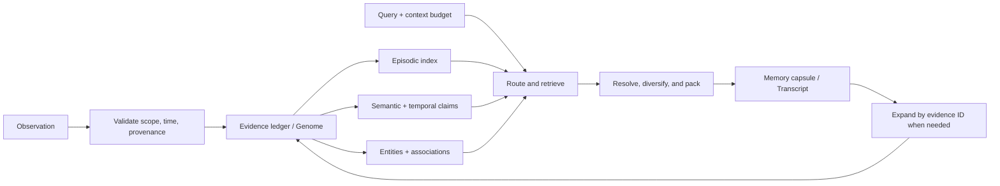

# EviCortex architecture

Status: implemented design contract for Prototype A, the provider-neutral Phase B diagnostic,
and the pinned-dense Phase C integration path. Official external evaluation, ANN, and service
work remains open.

## 1. Problem statement

A fixed-chunk RAG pipeline preserves documents but usually exposes only similarity-ranked
chunks to the model. That is a weak fit for long-running memory because:

- a fact can change without the old statement becoming irrelevant to historical questions;
- answers can require links across people, events, sessions, and time;
- large chunks waste context while small chunks lose surrounding evidence;
- generated summaries can erase details or silently merge contradictions;
- retrieval failures are difficult to diagnose when ranking decisions are opaque.

EviCortex will test whether separating durable evidence, mutable indexes, and bounded
context compilation improves the quality/cost frontier. It is still a retrieval-augmented
system in the broad technical sense. “Beyond RAG” here means beyond a flat top-k chunk
index, not the elimination of retrieval.

## 2. Biological inspiration, translated carefully

Human autobiographical memory is not stored as ordinary data in DNA. Neural memories
are dynamic engrams that pass through encoding, consolidation, retrieval, reconsolidation,
and forgetting. DNA and RNA are nevertheless useful *systems metaphors* for separating a
durable record from temporary, task-specific expression.

| Biological principle | Software mechanism | Limit of the analogy |
| --- | --- | --- |
| Stable genetic record | Append-only, digest-verified evidence ledger | Stored observations are not genes |
| Transcription into RNA | Query-specific context capsule | A capsule is selected evidence, not RNA |
| Fast hippocampal encoding | Cheap append-only episodic writes | SQLite is not a hippocampus |
| Systems consolidation | Background derivation of claims, links, and summaries | Consolidation can be wrong and remains reversible |
| Associative reactivation | Weighted graph and co-retrieval links | Scores approximate usefulness, not synaptic biology |
| Multiple memory systems | Episodic, semantic, procedural, and working views | The categories are engineering interfaces |

The engineering rule is stronger than the metaphor: **derived memory may be lossy; the
evidence from which it was derived must remain addressable and verifiable.**

## 3. Core invariants

1. **Evidence fidelity** — a successful write stores the original payload, a digest, source,
   scope, and timestamps. Index maintenance cannot silently rewrite it.
2. **Rebuildability** — deterministic claim/FTS indexes can be recreated from evidence plus
   explicit derivation records. Provider-derived semantic rows are preserved and repaired
   explicitly, per namespace, with a compatible provider.
3. **Temporal truth** — occurrence time and ingestion time are distinct. A current claim
   never erases the claims or evidence that preceded it.
4. **Bounded context** — capsule generation accepts a hard estimated-token budget and never
   exceeds it under the configured estimator.
5. **Progressive disclosure** — compact results expose stable evidence IDs for exact expansion.
6. **Traceable retrieval** — every result records which retrieval channels and score features
   selected it.
7. **Isolation before relevance** — namespace filtering runs before ranking; the host must
   authorize that namespace before calling the embedded library.
8. **Uncertainty is data** — confidence, contradictions, and abstention are represented rather
   than hidden in prose.
9. **Privacy beats append-only** — an authorized hard purge removes scoped evidence and
   rebuilds affected views. “Immutable” is not an excuse to retain data unlawfully.
10. **Claims require benchmarks** — no “better than RAG” statement without a named baseline,
    workload, model, context budget, and confidence interval.

For Prototype A, invariant 7 covers namespace filtering only. Namespace values are selected
by the API caller and are not authentication or authorization; a service adapter must enforce
those controls before calling the embedded store. Likewise, the local SQLite file is not
encrypted. Logical purge removes rows and projections but cannot guarantee forensic erasure
from filesystem snapshots, backups, journals, or underlying storage media.

## 4. Three-plane design



### 4.1 Evidence ledger (“Genome”)

The ledger stores observations, not conclusions. An observation can be a conversation turn,
document fragment, tool result, task outcome, explicit fact, or structured application event.

Minimum fields:

| Field | Purpose |
| --- | --- |
| `memory_id` | Stable opaque identifier |
| `namespace` | Tenant/application/user/agent isolation boundary |
| `kind` | Episode, document, tool result, explicit assertion, or procedure |
| `content` | Original payload or canonical serialized representation |
| `content_hash` | Integrity check for the exact stored content |
| `source` | URI or application-defined provenance |
| `occurred_at` | When the represented event happened |
| `recorded_at` | Logical ingestion time; generated by default or supplied by a trusted replay/import |
| `metadata` | Versioned, validated application metadata |

Large binary payloads will eventually live in a blob store while the ledger retains their
digest and locator. The prototype keeps text in SQLite.

### 4.2 Memory indexes (“Engram”)

All indexes are projections:

- **Episodic view:** ordered events with local surrounding context.
- **Semantic view:** atomic subject–predicate–value claims plus persistent, profile-bound
  memory/claim vectors linked to supporting evidence.
- **Temporal view:** validity intervals, recording time, supersession, and contradictions.
  Prototype A does not yet support transaction-time `known_at` queries.
- **Entity/relationship view:** aliases, typed entities, relations, and evidence-backed edges.
- **Lexical view:** FTS5 over exact evidence and normalized claim text.
- **Associative view:** explicit links plus co-retrieval/reinforcement weights.
- **Hierarchy view (later):** reversible summaries that point to child evidence.

The prototype does not pretend that heuristic or LLM extraction is ground truth. Applications
may provide structured claims directly; automatic extractors implement a provider-neutral
interface, are validated before the atomic write, and persist identity, content digest, exact
span provenance, diagnostics, and generated claim-ID mappings.

### 4.3 Context compiler (“Transcript”)

Retrieval produces a compact, structured `MemoryCapsule`, not an unexamined chunk list.

1. Parse query hints: entities, requested time, current-vs-historical intent, and memory kind.
2. Apply namespace and policy filters.
3. Collect candidates independently from lexical, semantic, temporal, and graph channels.
4. Fuse ranks, expand only promising associations, and record score contributions.
5. Detect stale/current conflicts and retain evidence needed to explain the resolution.
6. Diversify near-duplicates.
7. Pack the highest-utility evidence into the hard estimated-token budget.
8. Return compact claims/episodes, citations, uncertainty, omitted-result counts, and an
   expansion handle.

The compiler is deterministic by default. An optional LLM compressor may be added only if
its output is linked to exact evidence and its accuracy/cost is benchmarked separately.

## 5. Versioned claim model

A claim is an interpretation of evidence:

```text
Claim(
  subject, predicate, value,
  valid_from, valid_to,
  recorded_at,
  confidence,
  evidence_ids[],
  supersedes_claim_id?,
  status = active | superseded | disputed
)
```

Example:

```text
2026-01-02  user:varun prefers_theme light   [evidence m1]
2026-04-18  user:varun prefers_theme dark    [evidence m9, supersedes first]
```

“What theme does Varun prefer?” should select the second claim. “What did Varun prefer in
February?” should select the first. Both should remain expandable to their original evidence.

## 6. Public API shape for the prototype

```python
memory = EviCortex.open("memory.db")

memory.remember(
    namespace="demo/user-1",
    content="I switched from light mode to dark mode today.",
    source="conversation/session-7/turn-12",
    occurred_at="2026-04-18T09:30:00Z",
    claims=[
        ClaimInput(
            subject="user:1",
            predicate="prefers_theme",
            value="dark",
            supersedes="claim-id-for-light",
        )
    ],
)

capsule = memory.recall(
    namespace="demo/user-1",
    query="Which theme should I use for this user?",
    budget_tokens=300,
)

exact = memory.expand(namespace="demo/user-1", memory_id="...")
```

Phase B adds an auditable raw-evidence path and explicit semantic repair:

```python
memory = EviCortex.open(
    "memory.db",
    extractor=my_claim_extractor,
    embedder=my_embedder,
)
record = memory.remember_extracted(namespace="demo/user-1", content=raw_text)
run = memory.get_extraction("demo/user-1", record.id)
status = memory.sync_semantic("demo/user-1")
```

`rebuild_indexes()` repairs deterministic claim-status and FTS projections only. It never
silently invokes a provider or crosses namespaces; semantic repair is the explicit
`sync_semantic(namespace)` operation.

## 7. What makes the hypothesis falsifiable

EviCortex fails its first hypothesis if, under the same source data and context budget, a
well-tuned fixed-chunk RAG baseline matches or beats it on evidence recall, temporal update
handling, and answer support while being no more expensive. A negative result is useful: the
benchmark will reveal whether complexity belongs in indexing, query planning, or nowhere.

See [the benchmark contract](benchmark-contract.md) for the exact comparison rules.

## 8. Staged implementation

### Prototype A — deterministic memory kernel

- Python 3.12, SQLite, FTS5, standard library only.
- Evidence ledger, explicit claims, namespace isolation, temporal revisions.
- Lexical/entity/temporal candidate generation and score tracing.
- Hard-budget capsule compiler and evidence expansion.
- Synthetic streaming benchmark and fixed-chunk lexical RAG baseline.

### Prototype B — semantic and consolidation plugins

- Implemented: pluggable embedder, reranker, and structured extractor interfaces.
- Implemented: durable extraction provenance, persistent exact-vector projections, explicit
  repair, bounded lexical-semantic fusion, and a metadata-aware diagnostic comparator.
- Open: background consolidation, hierarchical reversible summaries, ANN, and learned or
  optimized retrieval routing.
- Implemented: strict LongMemEval schema/metric adapter and reader-free local runner.
- Open: official LongMemEval run, LoCoMo/MemoryAgentBench, and a shared reader model.

### Prototype C — pinned dense and external evaluation

- Safetensors-only local Transformers adapter with immutable model/code identity.
- Bounded optional reranking after filtering and deduplication.
- LongMemEval session retrieval under the same hard prompt budget for both systems.
- Open: official data, shared reader, calibrated support, and ANN recall/scale gates.

### Prototype D — service and scale

- Transactional service API, encryption, access control, audit logs, backup/restore.
- PostgreSQL/object-store adapters and incremental index rebuilds.
- Multi-process ingestion, observability, and adversarial memory-poisoning tests.

## 9. Research basis and differentiation risk

The design deliberately incorporates lessons already demonstrated by prior work:

- LongMemEval identifies extraction, multi-session reasoning, time, updates, and abstention
  as distinct capabilities: <https://arxiv.org/abs/2410.10813>
- HippoRAG 2 shows the value—and cost—of combining passages with an associative graph:
  <https://arxiv.org/abs/2502.14802>
- Zep demonstrates bitemporal knowledge graphs for changing agent memory:
  <https://arxiv.org/abs/2501.13956>
- MemMachine emphasizes preserving whole episodic ground truth:
  <https://arxiv.org/abs/2604.04853>
- H-Mem combines temporal-semantic hierarchy with a graph:
  <https://arxiv.org/abs/2605.15701>
- A 2026 study argues that data structure is a major quality determinant and evaluates the
  full streaming lifecycle: <https://arxiv.org/abs/2602.13967>

Therefore, “hybrid graph + vector memory” is not a novel contribution by itself. EviCortex’s
candidate differentiator is the enforceable contract across lossless evidence, rebuildable
views, temporal resolution, progressive disclosure, and budget-aware compilation. The
benchmark—not branding—must establish whether that combination matters.
