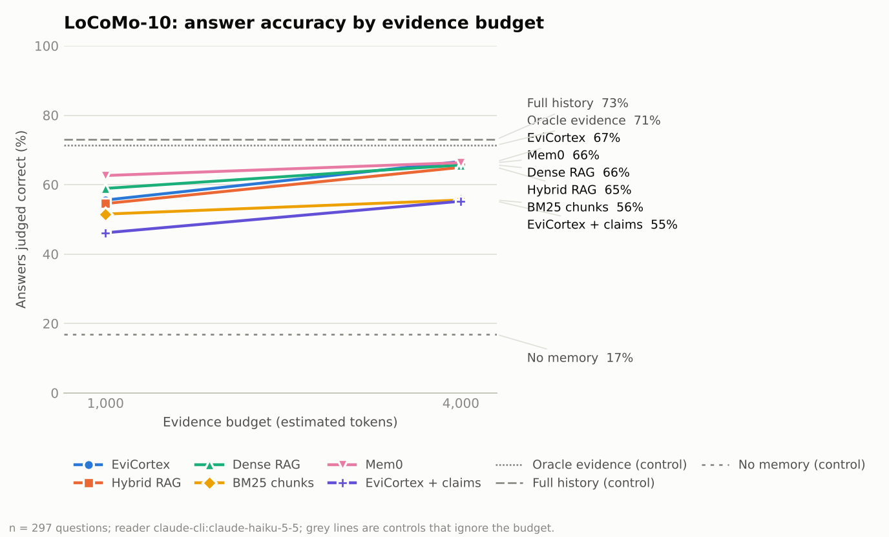
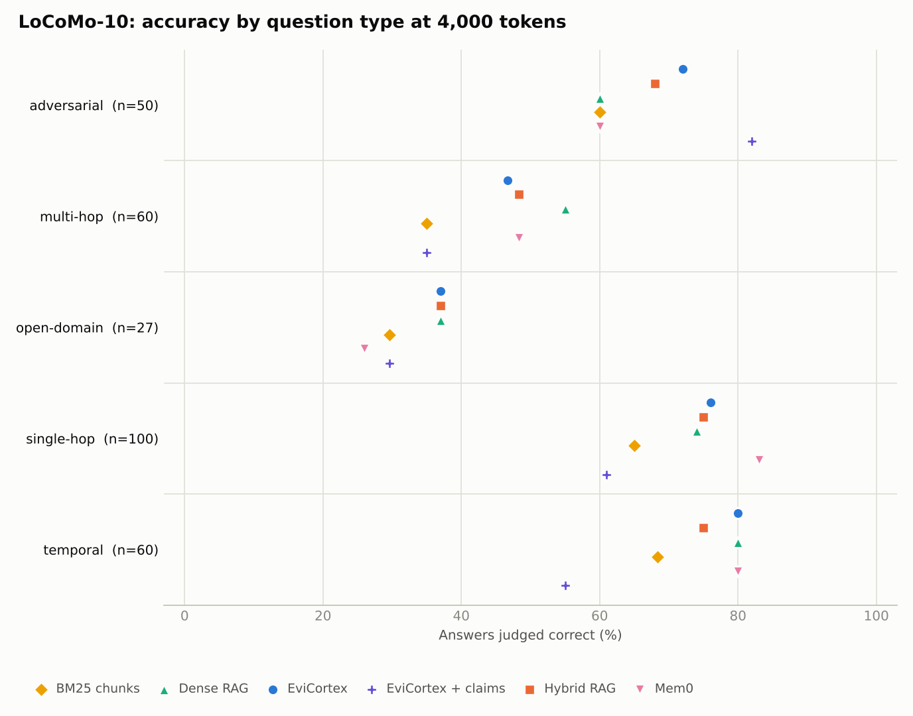
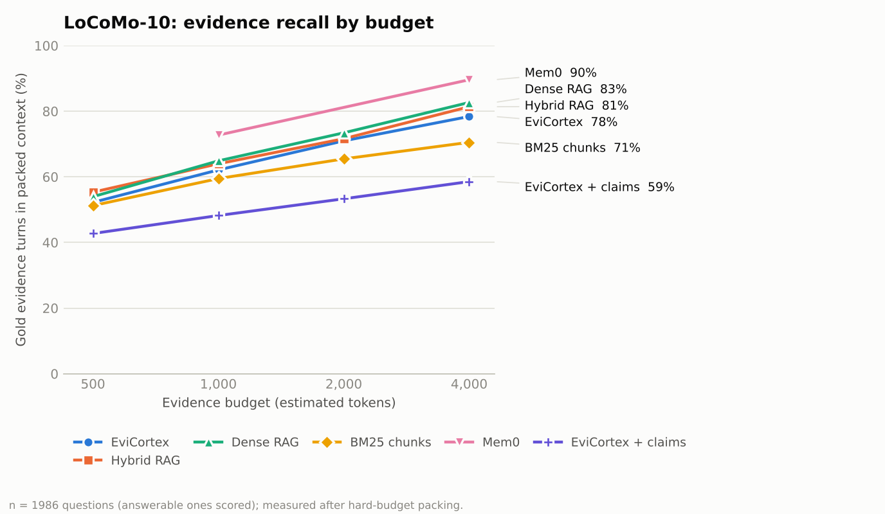
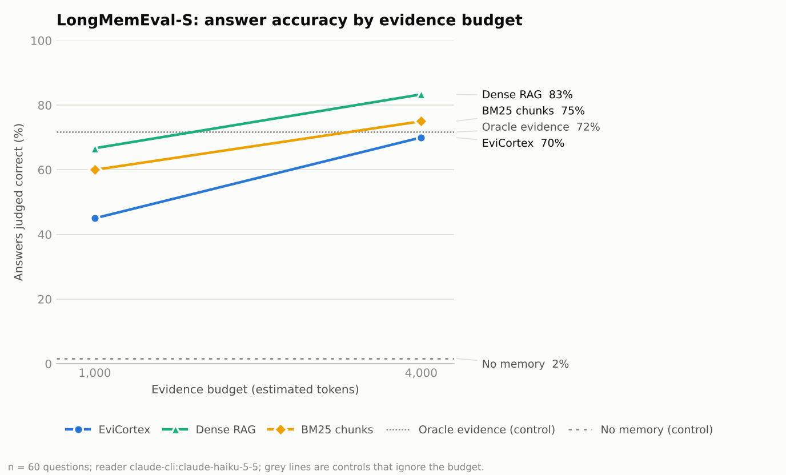
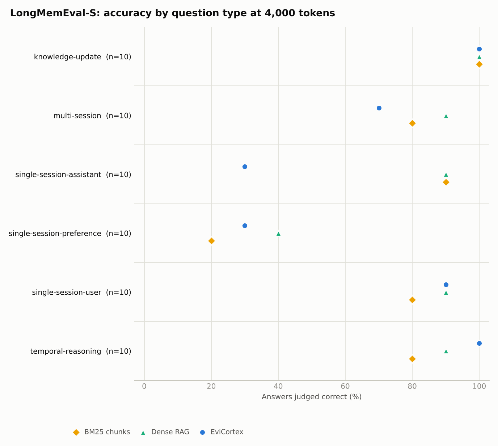

# Phase D result: comparison against other memory systems

Status: single run, 10 November 2026. Protocol and known limits are in
[Phase D](../phase-d.md). Every number below comes from
[summary.json](phase-d/summary.json); per-answer verdicts are in
[judgments.jsonl](phase-d/judgments.jsonl).

## What this run shows

- **EviCortex did not beat the baselines.** On LoCoMo at a 4,000-token evidence budget,
  EviCortex, Mem0, dense RAG, and hybrid RAG all answer 65–67% of questions correctly, and
  the differences are inside the uncertainty. At 1,000 tokens EviCortex is behind Mem0 and
  dense RAG.
- **On the LongMemEval-S sample EviCortex is behind dense RAG** by 22 points at 1,000 tokens
  and 13 points at 4,000 tokens.
- **Adding LLM-extracted claims made EviCortex worse** on LoCoMo, by 9 to 12 points.
- **Giving the reader the whole conversation beat every memory system** on LoCoMo (73%), at
  about nine times the evidence tokens of the 4,000-token budget.
- EviCortex matched Mem0's accuracy at 4,000 tokens with no LLM calls at ingestion; Mem0
  needed 3,011.

The project's central hypothesis — a better evidence-quality/context-cost trade-off than
RAG — is therefore **not supported** by this run. The sections below give the numbers and
the specific places EviCortex loses.

## Configuration

- **Datasets:** LoCoMo-10 (SHA-256 `79fa87e9…`, verified) and the cleaned LongMemEval-S
  release (SHA-256 `d6f21ea9…`, verified).
- **Encoder:** `unsloth/bge-small-en-v1.5` at `7382f112…`, CLS pooling, BGE query prefix,
  256-token truncation, CPU.
- **Reader:** Claude Haiku 5.5. **Judge:** Claude Sonnet 5.5, blinded. **Judge audit:**
  Claude Opus 5.5. All through the Claude Code CLI 2.1.322 in headless mode.
- **Mem0:** `mem0ai` 2.2.1 with embedded Qdrant 1.20.0, Haiku 5.5 as its LLM, turns added
  two at a time.
- **Runtime:** Python 3.13.18, SQLite 3.53.1, Torch 2.15.0, Transformers 5.22.2, one 4-vCPU
  container shared by concurrent jobs. Transformers 5 is above the `<5` pin in
  `pyproject.toml`; installing Mem0 upgraded it, and the encoder loaded and ran.
- **Budgets:** evidence recall at 500, 1,000, 2,000, and 4,000 estimated tokens; answers at
  1,000 and 4,000.
- **Answer sample:** LoCoMo, 297 questions (seeded quota per conversation: 10 single-hop,
  6 multi-hop, 6 temporal, up to 3 open-domain, 5 adversarial). LongMemEval-S, 60 questions
  (seeded, 10 per question type; one of them is an abstention question).

## LoCoMo: answer accuracy

297 questions across 10 conversations. Intervals are 95% bootstrap intervals over
conversations. "vs EviCortex" is the paired difference in percentage points at the same
budget.

| System | 1,000 tokens | vs EviCortex | 4,000 tokens | vs EviCortex |
| --- | ---: | ---: | ---: | ---: |
| EviCortex | 55.6% [51.3, 59.6] | — | 66.7% [62.3, 71.4] | — |
| Mem0 | 62.6% [60.0, 65.7] | +7.1 [+2.7, +11.9] | 66.3% [64.6, 68.4] | −0.3 [−4.7, +3.4] |
| Dense RAG | 58.9% [55.6, 62.3] | +3.4 [+0.4, +6.4] | 65.7% [61.3, 69.4] | −1.0 [−3.7, +1.7] |
| Hybrid RAG | 54.5% [50.3, 58.6] | −1.0 [−5.1, +3.3] | 65.0% [62.0, 68.0] | −1.7 [−8.4, +4.8] |
| BM25 chunks | 51.5% [47.5, 55.0] | −4.0 [−7.1, −0.7] | 55.6% [51.2, 59.7] | −11.1 [−16.2, −6.1] |
| EviCortex + claims | 46.1% [39.8, 52.0] | −9.4 [−15.5, −5.0] | 55.2% [49.0, 61.0] | −11.5 [−18.6, −5.3] |

Controls, which ignore the budget:

| Control | Accuracy | Mean evidence tokens |
| --- | ---: | ---: |
| Full history | 73.1% [69.7, 76.3] | 34,536 |
| Oracle evidence (gold turns only) | 71.4% [66.7, 75.7] | 127 |
| No memory | 16.8% | 0 |

No memory scores 16.8% because it declines every question, which is correct for the 50
unanswerable ones and wrong for the rest.

### By question type at 4,000 tokens

| System | Single-hop (100) | Multi-hop (60) | Temporal (60) | Open-domain (27) | Unanswerable (50) |
| --- | ---: | ---: | ---: | ---: | ---: |
| EviCortex | 76% | 47% | 80% | 37% | 72% |
| Mem0 | 83% | 48% | 80% | 26% | 60% |
| Dense RAG | 74% | 55% | 80% | 37% | 60% |
| Hybrid RAG | 75% | 48% | 75% | 37% | 68% |
| BM25 chunks | 65% | 35% | 68% | 30% | 60% |
| EviCortex + claims | 61% | 35% | 55% | 30% | 82% |
| Full history | 85% | 62% | 92% | 41% | 58% |

Per-type cells have 27 to 100 questions each and are not individually significant.
Two patterns are consistent across systems: multi-hop and open-domain questions are hard
for every retrieval system, and systems that retrieve less decline more often, which
raises their score on unanswerable questions.

## LoCoMo: evidence recall

Share of gold turns present in the packed context, all 1,986 questions (the 1,535 with gold
turns are scored):

| System | 500 | 1,000 | 2,000 | 4,000 | Turns packed at 4,000 |
| --- | ---: | ---: | ---: | ---: | ---: |
| Dense RAG | 54.0% | 64.9% | 73.4% | 82.7% | 60.6 |
| Hybrid RAG | 55.3% | 64.0% | 71.6% | 81.4% | 47.0 |
| EviCortex | 52.2% | 62.1% | 71.0% | 78.4% | 35.1 |
| BM25 chunks | 51.2% | 59.5% | 65.5% | 70.5% | 50.6 |
| EviCortex + claims | 42.7% | 48.2% | 53.3% | 58.6% | 42.4 |

Mem0 was retrieved only for the 297 sampled questions: 72.7% at 1,000 and 89.6% at 4,000.
Each Mem0 memory maps back to the two-turn batch it was extracted from, so these two
figures are upper bounds and are not comparable with the rows above.

## LongMemEval-S sample

60 questions, each with its own haystack of about 500 turns. Intervals resample questions
and are wide.

| System | 1,000 tokens | vs EviCortex | 4,000 tokens | vs EviCortex |
| --- | ---: | ---: | ---: | ---: |
| EviCortex | 45.0% [33.3, 56.7] | — | 70.0% [58.3, 81.7] | — |
| Dense RAG | 66.7% [55.0, 78.3] | +21.7 [+8.3, +35.0] | 83.3% [73.3, 91.7] | +13.3 [+1.7, +25.0] |
| BM25 chunks | 60.0% [48.3, 71.7] | +15.0 [+3.3, +26.7] | 75.0% [63.3, 85.0] | +5.0 [−5.0, +15.0] |
| Oracle (gold sessions, 7,360 tokens) | 71.7% [60.0, 83.3] | | | |
| No memory | 1.7% | | | |

Gold-session recall at 4,000 tokens is high for all three (EviCortex 99%, dense 98%, BM25
94%), so EviCortex usually reaches the right session and still answers less often.

The largest gap is on questions about what the assistant said earlier
(single-session-assistant): EviCortex answers 3 of 10 at both budgets, while dense RAG and
BM25 answer 9 of 10. Assistant turns in this dataset are long. EviCortex embeds only the
first 256 tokens of a turn and packs excerpts of long turns, whereas the chunk baselines
index and return every 600-character window. That is the likely cause; it was not isolated
by an ablation.

Mem0, hybrid RAG, full history, and the claims configuration were not run on LongMemEval-S.
A first attempt that included hybrid RAG took about seven minutes per question on this
machine, so hybrid RAG was dropped;
Mem0 and claim extraction would have needed LLM calls over roughly 30,000 long turns.

## Cost

Ingestion, LoCoMo (5,882 turns):

| System | LLM calls | LLM tokens in / out | LLM cost | Wall time |
| --- | ---: | ---: | ---: | ---: |
| EviCortex | 0 | 0 | $0 | 943 s |
| Hybrid RAG | 0 | 0 | $0 | 928 s |
| Dense RAG | 0 | 0 | $0 | 662 s |
| BM25 chunks | 0 | 0 | $0 | 163 s |
| EviCortex + claims | 272 | 1.21M / 0.61M | $0.52 | 1,279 s plus extraction |
| Mem0 | 3,011 | 45.8M / 3.5M | $3.91 | 37,706 s summed over 10 parallel processes |

Wall times were measured while several jobs shared four CPUs, so they are indicative only.
Mem0 stored 6,676 memories; one of its 3,011 batches failed to parse and stored nothing.

Reader input per question on LoCoMo, from the provider's own token counts:

| Context | Mean reader input tokens |
| --- | ---: |
| Oracle evidence | 1,656 |
| Mem0, 1,000-token budget | 2,581 |
| EviCortex, 1,000-token budget | 2,838 |
| Mem0, 4,000-token budget | 5,813 |
| Dense RAG, 4,000-token budget | 6,327 |
| EviCortex, 4,000-token budget | 6,907 |
| Full history | 41,621 |

About 1,500 of those tokens are the fixed prompt and CLI overhead. At the same estimated
budget EviCortex's capsule costs the reader more real tokens than Mem0's plain text or the
dense baseline's JSON, because of its per-item identifiers and timestamps.

Evaluation cost for this run: reader $6.78, judge $3.95, audit $0.69.

## Judge audit

| Dataset | Answers re-graded by Opus 5.5 | Agreement with Sonnet 5.5 | Cohen's kappa |
| --- | ---: | ---: | ---: |
| LoCoMo | 160 | 95.0% | 0.88 |
| LongMemEval-S | 100 | 96.0% | 0.78 |

Agreement was between 90% and 100% for every system, so the judge does not appear to favour
one system. This is agreement between two models, not human calibration.

## What the run says about EviCortex

1. **Capsule overhead costs evidence.** At 4,000 tokens EviCortex packs 35 turns where
   dense RAG packs 61. Each capsule item carries a 36-character evidence ID, a full
   timestamp, and a source field. Recall and low-budget accuracy both trail dense RAG by
   about that margin.
2. **Long turns are handled poorly.** See the LongMemEval-S assistant-turn result above.
3. **Claims crowd out evidence.** With claims present, the compiler filled the capsule
   almost entirely with facts (45.2 facts and 0.1 episodes on average at 4,000 tokens). The reader then saw paraphrases without the original wording, and
   declined 30% of answerable questions against 19% without claims. The extractor is a
   minimal one written for this benchmark, so this result reflects both the extractor and
   the compiler's fact-first packing.
4. **Retrieval ranking is on par with hybrid RAG**, not better. The answer-level difference
   between EviCortex and hybrid RAG is within noise at both budgets.
5. **The useful property that did show up is cost at ingestion:** equal accuracy to Mem0 at
   4,000 tokens with no LLM calls, no extraction errors, and exact source attribution.

## Dataset findings

- 13 of the 500 LongMemEval-S haystacks reuse a session ID for a different session. The
  strict loader in `benchmarks/longmemeval.py` rejects the official file for this reason;
  the Phase D loader keeps them as distinct sessions.
- 44 of the 500 LongMemEval-S questions have a gold answer session dated after the question
  date. A retrieval cutoff at the question date hides required evidence, so Phase D applies
  none. The Phase C runner passes the question date as `as_of` and is affected.

## Claim boundaries

- One run, one reader, one judge, one encoder, CPU only. No hyperparameters were tuned for
  any system, and none were tuned on a development split.
- LoCoMo answers are a 297-question stratified sample with fixed quotas, so pooled accuracy
  is not the accuracy over all 1,986 questions.
- The LongMemEval-S result is a 60-question sample, 12% of the release.
- No comparison is made with Graphiti/Zep, HippoRAG 2, MemMachine, or any hosted product,
  and no published score is quoted.
- The judge is a model. Agreement with a second model is reported; human calibration is not.
- Allowed statement: "On LoCoMo-10 with Haiku 5.5 as reader and a 4,000-token evidence
  budget, EviCortex, Mem0, dense RAG, and hybrid RAG were not distinguishable; full history
  was 6 points better." Not supported: any statement that EviCortex outperforms RAG or Mem0.
